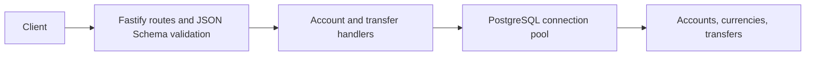

# Financial Backend

## What it does

A small REST API for reading account balances and transferring money between accounts in the same currency. This backend learning project focuses on database consistency, concurrent balance updates, and safe request retries.

## Architecture

**Stack:** TypeScript, Node.js, Fastify, PostgreSQL, and `pg`.



- `src/buildFastify.ts` builds the Fastify application and registers the database and route plugins. Tests use the same factory with `fastify.inject()`.
- `src/index.ts` starts the server with logging enabled.
- `src/plugins/routes/schemas/` defines request validation; TypeScript request types are derived from the schemas.
- Handler factories receive the Fastify instance, keeping route registration separate from database operations.
- SQL migrations define accounts, currencies, transfers, constraints, and a trigger that prevents account currency changes.
- A transfer inserts its record, locks both accounts in ID order, debits the source, credits the target, and commits within one transaction.

| Endpoint | Behavior |
| --- | --- |
| `GET /accounts/:id` | Returns an account, or `404` when it does not exist. |
| `POST /transfers` | Requires an `Idempotency-Key` header; returns `201` for a new transfer. |
| Repeated transfer request | Returns `200` with the original transfer ID when the key and payload match; `409` when the key is reused with different details. |

## Engineering challenges

- **Concurrent transfers:** the handler locks both accounts in ID order with `FOR NO KEY UPDATE` to coordinate balance updates while allowing the foreign-key checks on transfer inserts. Integration tests cover 50 requests in one direction and 50 requests alternating directions.
- **Atomic balance changes:** the transfer record, debit, and credit share a transaction, so a failed operation rolls back the entire transfer.
- **Retry safety:** a unique database constraint arbitrates duplicate idempotency keys, including competing requests. After rollback, the handler compares the stored transfer with the requested payload.
- **Money representation:** balances and transfers use integer minor units in PostgreSQL `bigint` columns. The request schema currently caps each transfer at `2147483647`; PostgreSQL bigint values returned by `pg` are strings by default.
- **Database invariants:** nonnegative balances, positive transfer amounts, distinct accounts, and matching currencies are enforced by constraints as well as request validation where applicable.

Integration tests in `tests/postTransfers.test.ts` exercise successful transfers, invalid account combinations, insufficient funds, idempotent retries, and concurrent balance updates. See [Testing](#testing) for database setup.

## How to run it

Prerequisites: Node.js 22.12+ in the 22.x line, Node.js 24.x, or Node.js 26+ (matching the installed Vitest requirement), npm, a running PostgreSQL server, and the `psql` and `createdb` CLIs. Use an empty development database.

```bash
git clone https://github.com/aleksanderantropov/financial-backend.git
cd financial-backend
npm ci
createdb financial_backend
```

Create a local `.env` file, adjusting credentials for your PostgreSQL installation:

```dotenv
DATABASE_URL=postgresql://localhost:5432/financial_backend
PORT=3000
```

Set the same connection URL in your shell for the database commands:

```bash
export DATABASE_URL='postgresql://localhost:5432/financial_backend'
psql "$DATABASE_URL" -v ON_ERROR_STOP=1 -f src/migrations/001_initial.sql
psql "$DATABASE_URL" -v ON_ERROR_STOP=1 -f src/migrations/002_seed_currencies.sql
```

Create the two USD accounts used by the examples on this fresh database:

```bash
psql "$DATABASE_URL" -v ON_ERROR_STOP=1 <<'SQL'
INSERT INTO accounts (name, amount_minor, currency_code) VALUES
  ('A', 10000, 'USD'),
  ('B', 5000, 'USD');
SQL
```

`src/seeds/development.sql` contains the same account fixtures, but is currently missing a semicolon after `BEGIN`. Use the command above until that script is corrected. Migrations and fixtures are intended to run once against a fresh database.

```bash
npm run dev
```

The server listens locally on port 3000 by default. For a compiled run:

```bash
npm run typecheck
npm run build
npm start
```

### Try the API

These examples assume two USD accounts with IDs 1 and 2, and at least 500 minor units in the source account:

```bash
curl http://localhost:3000/accounts/1

curl -X POST http://localhost:3000/transfers \
  -H 'Content-Type: application/json' \
  -H 'Idempotency-Key: demo-transfer-1' \
  -d '{"source_account_id":1,"target_account_id":2,"amount_minor":500,"currency_code":"USD"}'
```

Repeat the POST with the same key and body to retrieve the original transfer ID without moving money again. Fetch both accounts to inspect the updated balances.

### API responses and validation

`GET /accounts/:id` accepts an integer ID from 1 to `2147483647`. It returns the account's `id`, `name`, `amount_minor`, and `currency_code`, or `404` with `{"error":"Account not found"}`. Balances are JSON strings because `pg` returns PostgreSQL `bigint` values as strings.

`POST /transfers` requires all four body fields shown above and an `Idempotency-Key` header of 1–40 characters. Account IDs must be positive integers, `amount_minor` must be an integer from 1 to `2147483647`, and `currency_code` must contain three uppercase letters. Amounts are in the currency's minor unit: `500` means USD 5.00 for USD accounts.

| Status | Meaning |
| --- | --- |
| `201` | Transfer created; body: `{"transfer_id":1}` (ID varies). |
| `200` | Matching idempotent retry; returns the original `transfer_id`. |
| `400` | Schema validation failed, accounts are identical, funds are insufficient, or an account does not exist or does not support the requested currency. |
| `409` | The idempotency key already belongs to a transfer with different details. |
| `500` | Unexpected database or server failure. |

Idempotency keys are unique across all transfers. Reuse the same key and payload when retrying a transfer; use a new key for a new transfer. A failed transaction rolls back its transfer record and balance changes.

## Testing

Tests use Vitest, a real PostgreSQL database, and Fastify request injection. No separately running API server is required. **Use a dedicated test database: the suite truncates `transfers` and `accounts` and resets their identities before every test.**

Create and initialize an empty test database with the schema and currencies:

```bash
createdb financial_backend_test
export TEST_DATABASE_URL='postgresql://localhost:5432/financial_backend_test'
psql "$TEST_DATABASE_URL" -v ON_ERROR_STOP=1 -f src/migrations/001_initial.sql
psql "$TEST_DATABASE_URL" -v ON_ERROR_STOP=1 -f src/migrations/002_seed_currencies.sql
```

Create or update `.env.test` with your test database connection:

```dotenv
DATABASE_URL=postgresql://localhost:5432/financial_backend_test
```

The test script loads `.env.test`; an existing shell `DATABASE_URL` takes precedence over values in that file. Explicitly select the test database when running tests:

```bash
DATABASE_URL="$TEST_DATABASE_URL" npm test -- --run
```

Omit `--run` for Vitest watch mode. Tests create their own accounts; the development account seed is unnecessary.

Current coverage includes:

- Successful transfers and resulting account balances.
- Identical accounts, missing source or target accounts, currency mismatches, and insufficient funds.
- Concurrent requests sharing an idempotency key and conflicting reuse of a key.
- Fifty concurrent transfers in one direction and fifty alternating directions, with final balance checks.

Schema validation, dedicated account lookup cases, and broader rollback/failure scenarios remain areas for additional coverage. The two-request test named for opposite-direction concurrency currently awaits each request sequentially; the fifty-request test exercises actual concurrent requests in both directions.

## Current limitations

- Only balance lookup and same-currency transfers are exposed. Account creation, authentication, authorization, transaction history, and currency conversion are not implemented.
- Unexpected database failures still surface as generic server errors; deadlock retries are not implemented.
- The development-account seed script is missing a semicolon after `BEGIN`. The currency seed is runnable; migration and seed automation remain future work.
- Add operational controls such as graceful shutdown, request limits, and deadlock retry handling before expanding deployment scope.
